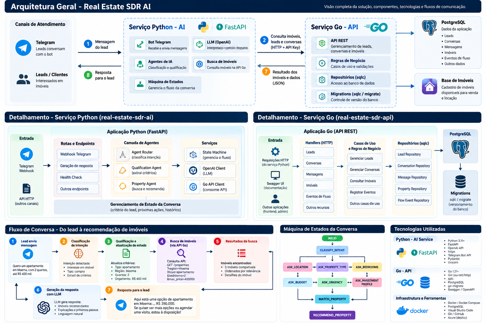
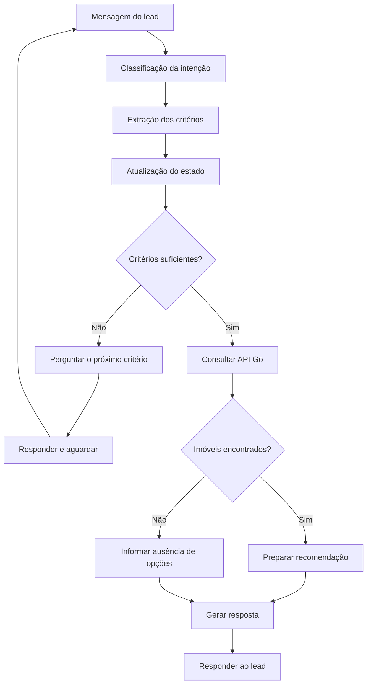

# Real Estate SDR --- Arquitetura e Guia de Execução

## 🏛️ Arquitetura da Solução



Documentação dos dois serviços da solução:

-   **`real-estate-sdr-api`**: backend Go, API REST e persistência
    PostgreSQL.
-   **`real-estate-sdr-ai`**: serviço Python/FastAPI para atendimento
    conversacional, qualificação do lead, integração com LLM e
    recomendação de imóveis.

> Os repositórios são separados. Este documento considera Windows
> PowerShell e os caminhos usados no desenvolvimento. Confirme nomes de
> variáveis, rotas e entrypoints no checkout atual. Nunca versione
> `.env` nem chaves.

## 🗺️ 1. Visão geral

``` text
Lead / canal de entrada (ex.: Telegram)
             |
             v
Python AI — localhost:8001
  FastAPI, agentes, estado da conversa,
  prompts, integração LLM e cliente HTTP
             |
             | HTTP + X-Correlation-ID
             v
Go API — localhost:8080
  HTTP handlers/middleware
  Application / casos de uso
  Domain / regras de negócio
  Repositories / Infrastructure / sqlc
             |
             v
PostgreSQL — localhost:5432
```

O Python conversa com o backend Go por HTTP. A persistência de negócio
fica concentrada na API Go; o Python não deve acessar diretamente o
PostgreSQL de negócio. O `X-Correlation-ID` permite correlacionar logs
entre os serviços.

## # 🐍 2. Projeto Python --- `real-estate-sdr-ai`

### Responsabilidade

Receber/processar mensagens, interpretar intenção, manter o estado da
conversa, qualificar critérios (tipo de imóvel, região, orçamento,
quartos e urgência), chamar o LLM e consultar a API Go para localizar
imóveis compatíveis.

### Estrutura conhecida

``` text
real-estate-sdr-ai/
├── ai/
│   └── app/
│       ├── main.py       # aplicação FastAPI
│       ├── agent/        # agentes e fluxo conversacional
│       ├── api/          # endpoints e rotas
│       ├── clients/      # clientes HTTP para serviços externos/API Go
│       ├── llm/          # integração com modelo de linguagem
│       ├── models/       # modelos de entrada/saída
│       ├── prompt/       # prompts
│       └── services/     # serviços de aplicação e lógica de apoio
├── requirements.txt      # dependências, se localizado na raiz
├── .env.example          # modelo de configuração, se presente
├── .env                  # configuração local/secrets; não versionar
└── .venv/                # ambiente virtual local; não versionar
```

Confira os arquivos reais com `Get-ChildItem -Recurse .\ai\app`; a lista
acima é a organização lógica conhecida, não uma garantia de que todos os
diretórios estejam preenchidos.

### Fluxo de processamento

1.  A API recebe a mensagem e identifica o lead/conversa.
2.  O serviço carrega o estado conversacional conhecido.
3.  O fluxo de agente/qualificação identifica intenção e critérios.
4.  O LLM interpreta a mensagem e/ou ajuda a compor a resposta conforme
    os prompts configurados.
5.  O estado é atualizado e a máquina de estados define a próxima ação.
6.  Quando precisa buscar imóveis, Python chama a API Go.
7.  O resultado é convertido em recomendação ou resposta sem resultados.
8.  A API devolve a resposta ao canal de entrada.

### Inicialização no Windows PowerShell

``` powershell
cd \codes\fiap\8IADT-tech-challenge-fase-5\real-estate-sdr-ai
py -3.11 -m venv .venv
.\.venv\Scripts\Activate.ps1
python -m pip install --upgrade pip
python -m pip install -r requirements.txt
```

Se `.venv` já existir, não é necessário recriá-lo. Se o PowerShell
bloquear a ativação, use o executável diretamente em
`.venv\Scripts\python.exe`.

Configure o `.env` com base no `.env.example`, se existir. Confira as
variáveis realmente lidas pelo código, incluindo a chave do provedor LLM
(por exemplo, `OPENAI_API_KEY`, se aplicável), a chave interna
(`AI_SERVICE_API_KEY`, se usada) e a URL da API Go. Não coloque valores
secretos no README.

Inicie a API:

``` powershell
.\.venv\Scripts\python.exe -m uvicorn ai.app.main:app --host 0.0.0.0 --port 8001 --reload
```

Em outro terminal:

``` powershell
Invoke-RestMethod http://localhost:8001/health
```

Se estiver habilitado, a documentação OpenAPI costuma ficar em
`http://localhost:8001/docs`; confirme no `ai/app/main.py`.

### Testes Python

Na raiz do projeto:

``` powershell
.\.venv\Scripts\python.exe -m pytest -v
.\.venv\Scripts\python.exe -m pytest -q
```

Durante o desenvolvimento, a suíte chegou a passar com 68 testes. O
número pode mudar; considere o resultado do checkout atual como
referência.

## 🐹 3. Projeto Go --- `real-estate-sdr-api`

### Responsabilidade

Expor endpoints REST, aplicar regras de negócio, coordenar casos de uso
e persistir os dados em PostgreSQL. O projeto contém migrations SQL e
consultas organizadas com `sqlc`.

### Estrutura conhecida

``` text
real-estate-sdr-api/
├── .env
├── .env.example
├── docker-compose.yml
├── scripts/
└── backend/
    ├── cmd/              # entrypoints
    ├── internal/
    │   ├── application/  # casos de uso/orquestração
    │   ├── domain/       # conceitos e regras de domínio
    │   ├── http/         # handlers, rotas, middleware e integração HTTP
    │   ├── infrastructure/# banco e integrações técnicas
    │   ├── repository/   # acesso a dados
    │   └── observability/# logging/correlação, conforme implementação
    ├── migrations/       # migrations SQL
    ├── queries/          # consultas SQL usadas pelo sqlc
    ├── Dockerfile
    ├── go.mod
    └── sqlc.yaml
```

Confirme a estrutura exata com
`Get-ChildItem .\backend\internal -Recurse`.

### Camadas

-   **Domain:** regras e conceitos do negócio, sem depender de detalhes
    de HTTP ou banco.
-   **Application:** coordena casos de uso.
-   **HTTP/API:** recebe requisições, valida dados de transporte e chama
    os casos de uso.
-   **Repository/Infrastructure:** implementa persistência e integrações
    externas.
-   **Queries/sqlc:** consultas SQL e código Go tipado gerado.
-   **Migrations:** evolução versionada do schema.

A direção recomendada das dependências é de fora para dentro:
handlers/infraestrutura dependem de casos de uso e abstrações; o domínio
deve permanecer independente de detalhes técnicos.

### Subir infraestrutura com Docker Compose

Na raiz de `real-estate-sdr-api`:

``` powershell
cd \codes\fiap\8IADT-tech-challenge-fase-5\real-estate-sdr-api
Get-Content .\docker-compose.yml
docker compose up -d
docker compose ps
```

O ambiente usado durante o desenvolvimento tem PostgreSQL em
`real-estate-sdr-postgres`, banco `real_estate_sdr`, porta local `5432`.
Use o `docker-compose.yml` atual para confirmar serviço, credenciais,
volume e portas.

Se houver `.env.example`, crie o `.env` local a partir dele e preencha
os valores necessários. Não compartilhe credenciais.

### Migrations

As migrations ficam em `backend/migrations`. O banco usado no
desenvolvimento registrou migrations `001` a `007`. A migration 007
adicionou `properties.status`, cujos valores válidos incluem
`AVAILABLE`, `RESERVED`, `SOLD`, `RENTED` e `INACTIVE`.

Ter migrations no banco não garante que um banco novo será migrado
automaticamente. Verifique no código/scripts se a aplicação aplica
migrations no startup ou se há um comando específico. Não apague volumes
nem execute alterações destrutivas sem backup.

### Executar e testar Go

``` powershell
cd .\backend
go mod download
go test -count=1 ./...
```

Para localizar o entrypoint:

``` powershell
Get-ChildItem .\cmd -Recurse
```

Execute o pacote que realmente existir em `cmd`. Se o entrypoint for
`cmd\api`, por exemplo:

``` powershell
go run .\cmd\api
```

A API local foi configurada para a porta `8080`. Valide:

``` powershell
Invoke-RestMethod http://localhost:8080/health
Invoke-RestMethod http://localhost:8080/ready
```

Se a aplicação for executada pelo Compose, na raiz do projeto:

``` powershell
docker compose up --build -d
docker compose ps
docker compose logs -f
```

Não execute `docker compose` dentro de `backend` se o arquivo estiver
somente na raiz.

## ⚙️ 4. Configuração e integração Python ↔ Go

A URL usada pelo Python deve corresponder à topologia em que os serviços
estão rodando.

-   **Ambos no Windows:** o Python pode usar `http://localhost:8080`
    para alcançar a API Go local.
-   **Go em Docker, Python no Windows:** com a porta Go publicada,
    normalmente use `http://localhost:8080`.
-   **Python em Docker, Go no host:** no Docker Desktop para Windows,
    use `http://host.docker.internal:8080` se a porta do host estiver
    publicada.
-   **Ambos no Compose:** use o nome DNS do serviço Go e a porta interna
    do container; `localhost` dentro de um container aponta para o
    próprio container.
-   **Azure/produção:** não use `host.docker.internal`; configure a URL
    pública/privada correta e proteja a comunicação.

No ambiente de desenvolvimento são usadas `API_KEY`/`X-API-Key` para
chamadas protegidas da API Go e, quando habilitado,
`AI_SERVICE_API_KEY`/`X-Internal-API-Key` para o serviço de IA. Confira
os middlewares e clientes para saber quais endpoints exigem
autenticação.

## 🧪 5. Ordem recomendada para iniciar tudo

Abra terminais separados.

### Terminal 1 --- banco e infraestrutura

``` powershell
cd \codes\fiap\8IADT-tech-challenge-fase-5\real-estate-sdr-api
docker compose up -d
docker compose ps
```

Confirme que o PostgreSQL está saudável e que as migrations necessárias
foram aplicadas.

### Terminal 2 --- API Go

Se o Compose já iniciar a API, acompanhe os logs:

``` powershell
docker compose logs -f
```

Se for executar diretamente, entre em `backend`, confira `cmd` e use o
entrypoint correto. Depois valide `/health` e `/ready` na porta `8080`.

### Terminal 3 --- Python AI

``` powershell
cd \codes\fiap\8IADT-tech-challenge-fase-5\real-estate-sdr-ai
.\.venv\Scripts\python.exe -m uvicorn ai.app.main:app --host 0.0.0.0 --port 8001 --reload
```

Valide `/health` na porta `8001`.

### Terminal 4 --- Telegram

O script conhecido é `ai/scripts/telegram_bot.py`; confirme o caminho
atual e as variáveis necessárias antes de iniciar:

``` powershell
cd \codes\fiap\8IADT-tech-challenge-fase-5\real-estate-sdr-ai
.\.venv\Scripts\python.exe .\ai\scripts\telegram_bot.py
```

O bot pode precisar de token Telegram e da URL/chave da API Go. Não
exponha esses valores em logs ou no Git.

## 🔍 6. Diagnóstico rápido

``` powershell
docker compose ps
docker compose logs --tail 100
Test-NetConnection localhost -Port 5432
Test-NetConnection localhost -Port 8080
Test-NetConnection localhost -Port 8001
Invoke-RestMethod http://localhost:8001/health
Invoke-RestMethod http://localhost:8080/health
Invoke-RestMethod http://localhost:8080/ready
```

Problemas frequentes:

-   **Python não alcança Go:** confirme a variável da URL base e a
    topologia host/container.
-   **401/403:** confira `X-API-Key` e/ou `X-Internal-API-Key`.
-   **Banco indisponível:** confira logs do PostgreSQL, credenciais,
    porta e configuração do Go.
-   **Tabela/coluna inexistente:** confira se as migrations foram
    aplicadas ao banco correto.
-   **Dependência Python ausente:** instale `requirements.txt` no
    `.venv` usado para iniciar a API.
-   **Falha em testes:** execute a partir da raiz correta e confira
    dependências externas exigidas.

## 🔐 7. Segurança e boas práticas

1.  Não versione `.env`, tokens ou chaves.
2.  Mantenha `.env.example` sem secrets reais.
3.  Não exponha PostgreSQL diretamente à internet.
4.  Proteja endpoints e valide entrada.
5.  Propague `X-Correlation-ID` e inclua-o nos logs.
6.  Configure timeouts e tratamento de falhas nos clientes HTTP.
7.  Centralize o acesso ao banco de negócio na API Go.
8.  Em produção, remova `--reload` e configure health checks, logs,
    recursos e secrets.
9.  Versione migrations e valide compatibilidade do schema antes do
    deploy.
10. Faça backup antes de operações destrutivas.

## 🔧 8. Checklist de inicialização

-   [ ] PostgreSQL iniciou sem erros.
-   [ ] Migrations necessárias estão aplicadas ao banco correto.
-   [ ] API Go iniciou; `/health` responde.
-   [ ] `/ready` confirma a prontidão do backend/banco.
-   [ ] `go test -count=1 ./...` passa.
-   [ ] `.venv` e dependências Python estão corretos.
-   [ ] Variáveis de ambiente do Python estão configuradas.
-   [ ] Python iniciou; `/health` responde.
-   [ ] Python alcança a API Go pela URL correta.
-   [ ] `python -m pytest -q` passa.
-   [ ] Uma requisição de ponta a ponta foi testada com lead de teste.
-   [ ] Logs permitem correlacionar a requisição entre Python e Go.

## 🔧 9. Itens para conferir no checkout atual

Antes de usar este documento como procedimento de produção, confirme:

-   caminho exato do entrypoint Go em `backend/cmd`;
-   nomes das variáveis de ambiente realmente lidas por cada serviço;
-   se o Compose aplica migrations automaticamente;
-   nomes dos serviços, portas e health checks no `docker-compose.yml`;
-   caminho real da suíte de testes Python;
-   rotas HTTP e requisitos de autenticação;
-   recursos adicionais necessários ao empacotamento Docker do Python.

Este README descreve a arquitetura conhecida durante o desenvolvimento e
evita tratar configurações locais específicas como garantidas em todos
os ambientes.

# 🔐 10. Segurança
Incluí também os principais controles a documentar e validar:
- Autenticação entre serviços: X-API-Key e X-Internal-API-Key, conforme as rotas configuradas.
- Proteção do banco: PostgreSQL sem exposição pública e privilégios mínimos.
- Segurança de dependências: análise de vulnerabilidades em pacotes e imagens Docker.
- Proteção de dados: evitar chaves, tokens e dados pessoais desnecessários nos logs, uso de arquivos .env.
- Resiliência: timeouts, validação de entrada e limites de requisições.

# 📊 11. Observabilidade
- Tracing distribuído com OpenTelemetry.
- X-Correlation-ID, Já identificado no fluxo para correlacionar requisições entre Python e Go.

# 12. 🛠️ Tecnologias

| Tecnologia | Finalidade |
|---|---|
| Python 3.11 | Linguagem principal |
| FastAPI | Framework para API HTTP |
| Uvicorn | Servidor ASGI |
| pytest | Testes automatizados |
| LLM / OpenAI | Interpretação e geração de respostas, conforme configuração |
| HTTP Client | Comunicação com a API Go |
| Docker | Containerização, quando configurada |

> Confira o `requirements.txt` para validar as bibliotecas e versões efetivamente utilizadas.


## 13 🔄 Fluxo de atendimento



O fluxo representa o comportamento esperado da solução. As transições devem ser conferidas na implementação atual da máquina de estados.
```


## 14. 🧩 Componentes principais

| Componente | Responsabilidade |
|---|---|
| FastAPI | Exposição dos endpoints HTTP |
| Agent Router | Direcionamento do fluxo conforme a intenção |
| Qualification Agent | Extração e qualificação dos critérios do lead |
| State Machine | Controle das etapas da conversa |
| Property Agent | Coordenação da busca e recomendação de imóveis |
| LLM Client | Integração com o modelo de linguagem |
| Go API Client | Comunicação com o backend de negócio |
| Property Matching Service | Aplicação dos critérios de compatibilidade |

> Os nomes e as responsabilidades devem ser ajustados caso a implementação atual utilize outras classes ou módulos.


## 15. 🧪 Testes automatizados

Execute os testes a partir da raiz do projeto:

```powershell
.\.venv\Scripts\python.exe -m pytest -v
```

Para uma execução resumida:

```powershell
.\.venv\Scripts\python.exe -m pytest -q
```

Os testes devem cobrir a extração de critérios, as mudanças de estado, a busca de imóveis, os casos sem resultados e o tratamento de falhas nas integrações.


## 16. 📊 Observabilidade

O serviço deve permitir acompanhar as requisições, falhas e latência das integrações.

- Logs estruturados.
- Propagação do `X-Correlation-ID`, conforme a implementação.
- Endpoint de saúde `/health`.
- Monitoramento das chamadas ao LLM e à API Go.

### Evolução recomendada

- OpenTelemetry para instrumentação de traces.
- Prometheus para coleta de métricas.
- Grafana para dashboards.
- Loki ou Azure Monitor para centralização de logs.

Essas ferramentas são recomendações e não devem ser consideradas implementadas sem validação no projeto.

## 🔐 Segurança

- Manter chaves e credenciais fora do Git.
- Utilizar variáveis de ambiente para configurações sensíveis.
- Validar mensagens e parâmetros recebidos.
- Configurar timeouts nas chamadas externas.
- Evitar registrar tokens ou dados pessoais desnecessários.
- Utilizar HTTPS em ambientes de produção.
- Tratar o conteúdo enviado ao LLM como entrada não confiável.


## 🧠 RAG — Retrieval-Augmented Generation

Este documento descreve a camada de **Retrieval-Augmented Generation (RAG)** do projeto `real-estate-sdr-ai`, responsável por recuperar informações de uma base de conhecimento e disponibilizá-las ao modelo de linguagem durante a geração de respostas.

> **Escopo:** a arquitetura abaixo registra os componentes conhecidos da implementação. A validação ponta a ponta deve ser confirmada no checkout atual, incluindo ingestão/indexação dos documentos e perguntas reais feitas pelo canal de atendimento.

### 🎯 Objetivo

O RAG complementa o contexto conversacional do lead com informações recuperadas de documentos de conhecimento do negócio. A intenção é permitir respostas mais consistentes sobre assuntos como:

- Regiões atendidas pela imobiliária, por exemplo, Moema.
- Informações gerais sobre financiamento.
- Orientações sobre visitas a imóveis.

O RAG é uma fonte de contexto para o LLM. Ele **não substitui** a busca estruturada de imóveis nem deve inventar disponibilidade, preços ou características que não estejam confirmados na API de negócio.

### 🏗️ Arquitetura

A implementação conhecida utiliza:

- **PostgreSQL + pgvector** para armazenar documentos e vetores.
- **OpenAI `text-embedding-3-small`** para gerar embeddings de 1536 dimensões.
- `EmbeddingService` para gerar embeddings.
- `KnowledgeRepository` para persistir e recuperar documentos por similaridade cosseno.
- `RAGService` para coordenar a recuperação de contexto.
- Integração com `AIService`, rotas de atendimento e `PromptBuilder` para fornecer o contexto recuperado ao prompt do LLM.

```text
Pergunta/mensagem do lead
          |
          v
       AIService
          |
          v
       RAGService
          |
          +----> EmbeddingService
          |         |
          |         v
          |    Embedding de consulta
          |
          v
   KnowledgeRepository
          |
          v
 PostgreSQL + pgvector
 (similaridade cosseno)
          |
          v
 Trechos/documentos relevantes
          |
          v
      PromptBuilder
          |
          v
           LLM
          |
          v
    Resposta ao lead
```

O diagrama representa o fluxo arquitetural esperado a partir dos componentes conhecidos. Confirme no código atual os detalhes de chamada, filtros, tratamento de ausência de resultados e formato do contexto.

###🔎 Como funciona o fluxo RAG

1. **Recebimento da mensagem:** o serviço de atendimento recebe a mensagem do lead.
2. **Geração do embedding:** o `EmbeddingService` transforma a consulta em um vetor usando `text-embedding-3-small`.
3. **Recuperação semântica:** o `KnowledgeRepository` consulta os documentos indexados no PostgreSQL com pgvector e ordena os resultados por similaridade cosseno.
4. **Montagem do contexto:** o `RAGService` coordena a recuperação e disponibiliza os trechos relevantes para o fluxo de geração.
5. **Construção do prompt:** o `PromptBuilder` incorpora o contexto recuperado ao prompt encaminhado ao LLM.
6. **Geração da resposta:** o LLM produz uma resposta com base na mensagem, no contexto conversacional e no material recuperado.

A qualidade da resposta depende da qualidade dos documentos, dos embeddings, dos parâmetros de recuperação e das instruções do prompt.

### 🗄️ Persistência e busca vetorial

A tabela conhecida para armazenar conhecimento é `knowledge_documents`. Ela é usada pela camada de persistência de conhecimento e pela busca semântica.

A extensão `pgvector` permite armazenar embeddings e realizar operações de similaridade diretamente no PostgreSQL, evitando a necessidade de um banco vetorial separado nesta arquitetura.

Antes de executar o projeto em um ambiente novo, confira as migrations e valide:

- Se a extensão `vector` está habilitada.
- Se a tabela `knowledge_documents` foi criada.
- Se a coluna vetorial tem a dimensão esperada (1536 para `text-embedding-3-small`).
- Se os documentos foram efetivamente inseridos e indexados.
- Se a consulta usa a métrica de similaridade esperada pela implementação.

> Os nomes exatos das colunas, índices e migrations devem ser conferidos no código SQL do projeto.

### 📚 Conteúdo da base de conhecimento

Os tipos de conteúdo considerados para a base incluem:

| Tema | Exemplo de informação |
|---|---|
| Regiões atendidas | Bairros e regiões em que a imobiliária atua |
| Financiamento | Orientações gerais sobre o processo de financiamento |
| Visitas | Orientações para agendamento e visita a imóveis |

A presença desses temas no desenho da solução não comprova, por si só, que todos os documentos já estejam carregados no banco. Verifique os registros de `knowledge_documents` no ambiente em execução.

### 🧩 Separação entre RAG e busca de imóveis

O projeto mantém duas responsabilidades distintas:

- **RAG:** recupera conhecimento textual para contextualizar respostas, como orientações sobre regiões, financiamento e visitas.
- **Property Matching:** consulta os dados estruturados dos imóveis e aplica critérios como tipo, região, orçamento, quartos e disponibilidade.

O RAG não deve ser usado como fonte definitiva para preço, status ou disponibilidade de um imóvel. Esses dados devem vir da API Go e da persistência de negócio.

### ⚙️ Configuração

A geração de embeddings depende de credenciais válidas do provedor de embeddings. Confira no código e no arquivo `.env.example` os nomes reais das variáveis de ambiente utilizadas.

Cuidados:

- Não versione o `.env` nem chaves de API.
- Mantenha credenciais fora do README.
- Confirme que o serviço consegue acessar o PostgreSQL.
- Verifique se a configuração do provedor de embeddings corresponde ao modelo usado na indexação.
- Evite misturar vetores gerados por modelos ou dimensões incompatíveis.

### 🧪 Validação e testes

A validação deve cobrir separadamente a geração de embeddings, a persistência, a recuperação semântica e a integração com a geração de respostas.

### Verificações recomendadas

- A extensão pgvector está habilitada no banco.
- A tabela `knowledge_documents` existe.
- Existem documentos de conhecimento indexados.
- O `EmbeddingService` gera vetores com a dimensão esperada.
- O `KnowledgeRepository` recupera documentos relevantes para uma consulta.
- O `RAGService` trata consultas sem resultados.
- O `PromptBuilder` recebe o contexto recuperado.
- A resposta final não apresenta conteúdo do RAG como fato quando o contexto não dá suporte.
- A busca estruturada de imóveis continua consultando a API Go.

### Exemplos de perguntas para um teste ponta a ponta

Use somente depois de confirmar que há documentos correspondentes na base:

- “Vocês atendem a região de Moema?”
- “Como funciona o processo de financiamento?”
- “Como posso agendar uma visita a um imóvel?”

Para cada teste, inspecione os documentos recuperados e confirme que a resposta final é consistente com o conteúdo armazenado. Esses exemplos são cenários de validação, não evidência de que a integração ponta a ponta já foi aprovada.

## 🔐 Segurança e confiabilidade

- Trate a mensagem do lead e o conteúdo recuperado como entradas não confiáveis.
- Instrua o LLM a não seguir instruções encontradas dentro dos documentos que tentem substituir as regras do sistema.
- Não armazene segredos ou dados pessoais desnecessários nos documentos.
- Registre falhas e métricas de recuperação sem expor chaves ou informações sensíveis.
- Quando não houver contexto relevante, prefira uma resposta limitada ou encaminhamento apropriado em vez de inventar informações.
- Não permita que o contexto recuperado substitua as regras de negócio da API Go.

## 📈 Melhorias futuras

Após validar o fluxo atual, melhorias possíveis incluem:

- Estratégia de divisão de documentos em trechos (*chunking*) e sobreposição.
- Metadados para filtrar documentos por categoria, região ou versão.
- Limiar mínimo de similaridade e controle do número de resultados recuperados.
- Avaliação com conjunto de perguntas e respostas esperadas.
- Métricas de recuperação, latência e taxa de consultas sem resultados.
- Versionamento e reindexação de documentos.
- Avaliação de respostas com e sem RAG.

Esses itens são sugestões de evolução e não devem ser considerados implementados sem verificação no repositório.

## 📌 Resumo

A camada RAG do `real-estate-sdr-ai` combina embeddings da OpenAI, PostgreSQL com pgvector, recuperação semântica por similaridade cosseno e integração do contexto recuperado ao prompt do LLM. Seu propósito é enriquecer respostas conversacionais com conhecimento do negócio, mantendo a busca estruturada de imóveis separada e sob responsabilidade da API Go.
